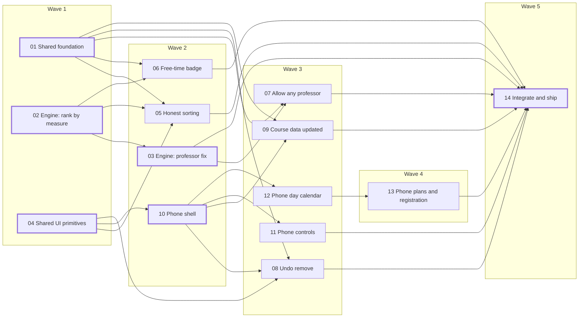

# Roadmap: MVP fixes

Source: [00-spec.md](00-spec.md). Execution order only, with no dates. A ticket starts when every ticket it's blocked by is merged. Tickets in the same wave run in parallel, in separate worktrees.

## Dependency graph



Thick borders mark shared-file and engine tickets: the lead's files, or the engine and its WebAssembly. The critical path is 04 → 10 → 12 → 13 → 14.

## Wave manifest

```waves
1: 01, 02, 04
2: 03, 05, 06, 10
3: 07, 08, 09, 11, 12
4: 13
5: 14
```

## Worktrees per wave

Run `./ralph/waves.sh feature/fixes` from the repository root (or omit the
branch argument to use the current branch). Ralph reads this manifest, creates
separate worktrees and `ralph/feature-fixes/<ticket>` branches for each wave,
then merges each completed wave into the selected base branch before starting
the next one. The ticket descriptions are read from the launching checkout, so
they do not need to be committed or copied into every worktree.

Existing worktrees and branches are never removed or overwritten. Ralph leaves
new worktrees and branches in place after merging so the work can be inspected;
if a ticket fails or a merge conflicts, it stops and preserves the worktrees
for recovery.

## Notes

- 03 waits for 02 because both rebuild the same WebAssembly file.
- 08 and 09 wait for 10 so only one ticket at a time edits the app shell.
- 01 changes the store's shapes against the contract that 02 writes down. Agree on the shape in 01 before either starts. If 02 has to change it, 01 follows.
- When agents run at the same time, use the port rules in the frontend architecture doc.
