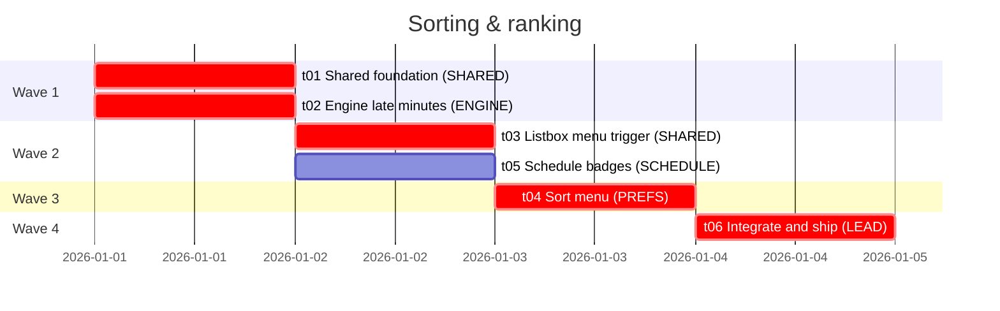

# Sorting & ranking: roadmap

From `issues/00-spec.md`. Every ticket branch starts from `feature/sorting` and merges back into it. Ticket 06 opens the one PR to `main`.

## Gantt



The critical path is 02 → 03 → 04 → 06. Tickets 01 and 03 are shared-file tickets: planner store and engine types, then UI primitives. They land before the feature tickets that use them, so parallel work never edits the same shared file.

## Worktrees per wave

Before Wave 1, once:

```sh
git switch main && git switch -c feature/sorting
```

| Wave | Tickets | Blocked by | Run together |
|---|---|---|---|
| 1 | 01, 02 | none | `git worktree add ../goatplan-01 -b feat/01 feature/sorting`<br>`git worktree add ../goatplan-02 -b feat/02 feature/sorting` |
| 2 | 03, 05 | 03 ← 02 · 05 ← 01, 02 | `git worktree add ../goatplan-03 -b feat/03 feature/sorting`<br>`git worktree add ../goatplan-05 -b feat/05 feature/sorting` |
| 3 | 04 | 01, 02, 03 | `git worktree add ../goatplan-04 -b feat/04 feature/sorting` |
| 4 | 06 | 04, 05 | `git worktree add ../goatplan-06 -b feat/06 feature/sorting` |

Between waves, merge each finished `feat/NN` into `feature/sorting` before you create the next wave's worktrees, so they start from the merged work. Remove a finished worktree with `git worktree remove ../goatplan-NN`.

Rules that hold for every wave:
- Engine work comes before UI work. 03, 04 and 05 all wait for 02.
- Only 01 and 03 edit shared lead files. 04 and 05 stay in their own feature folders and get the shared changes by merging.
- 02 is the only ticket that touches the engine. Its WebAssembly rebuild is in the same commit as its engine source.
